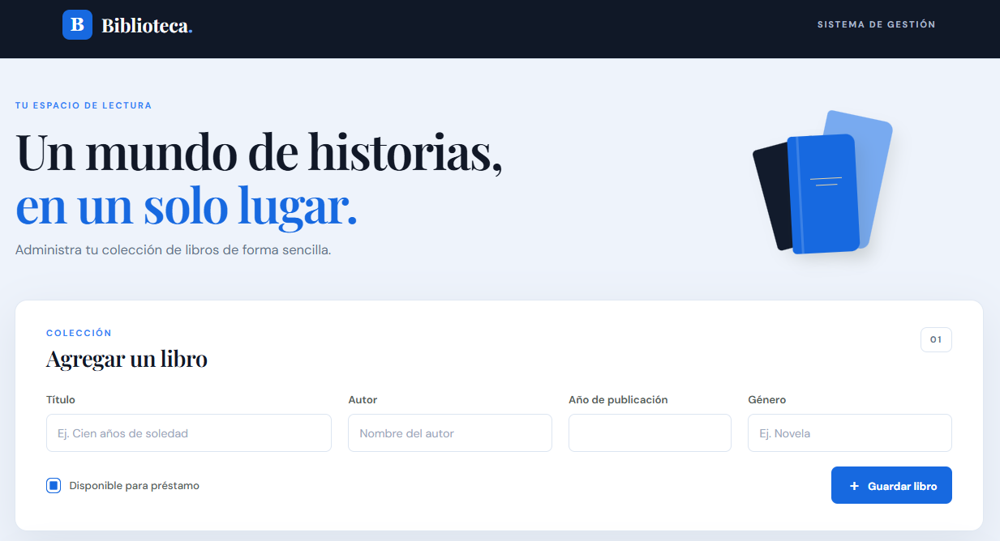
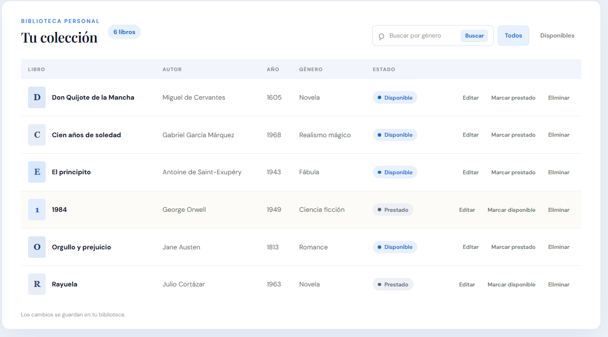

# Biblioteca Personal

Aplicación web para organizar tu colección de libros. Registra títulos, consulta el catálogo por género y lleva el control de los libros disponibles y prestados.



## Qué puedes hacer

- Agregar, editar y eliminar libros con su título, autor, año de publicación y género.
- Buscar libros por género y filtrar la colección para ver solo los disponibles.
- Marcar un libro como prestado y volver a marcarlo como disponible cuando lo devuelvan.



## Ejecutar en local

La interfaz usa HTML, CSS y JavaScript. El servidor usa Node.js y Express, y guarda los datos en MySQL mediante `mysql2`.

1. Con Node.js, npm y MySQL instalados, clona el repositorio e instala las dependencias.

   ```sh
   git clone https://github.com/soyjorgeuribe/libros-app.git
   cd libros-app
   npm ci
   ```

2. Con MySQL en ejecución, abre su cliente desde la carpeta del proyecto e importa el esquema.

   ```sh
   mysql -u root -p
   ```

   ```sql
   SOURCE biblioteca.sql;
   ```

3. Define las variables de entorno que correspondan a tu configuración y ejecuta `npm start`. Abre `http://localhost:3000` en el navegador si usas el puerto predeterminado.

| Variable | Valor predeterminado |
| --- | --- |
| `DB_HOST` | `localhost` |
| `DB_USER` | `root` |
| `DB_PASSWORD` | Cadena vacía |
| `DB_NAME` | `biblioteca` |
| `PORT` | `3000` |
